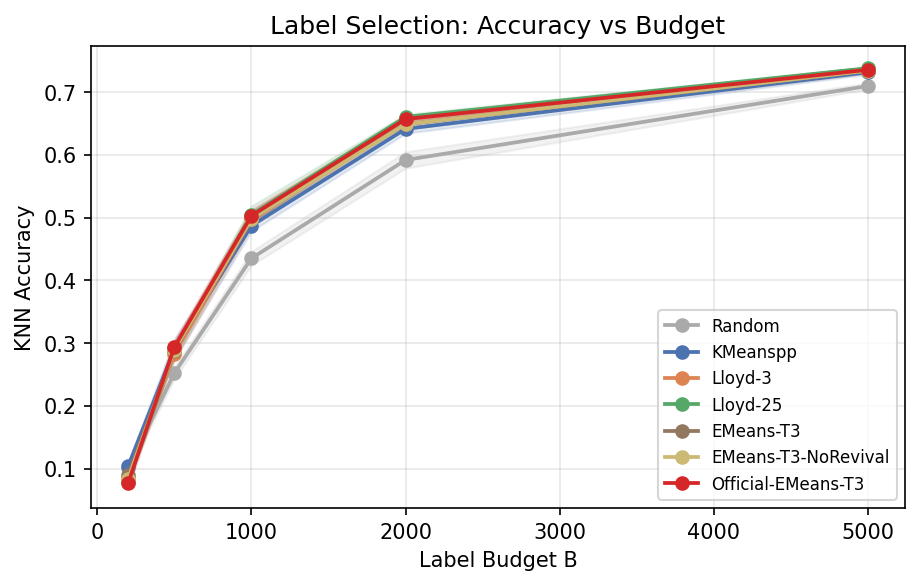
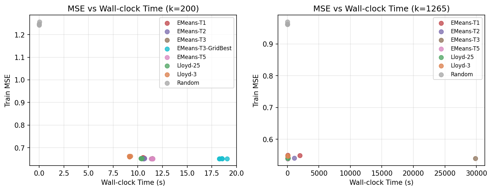
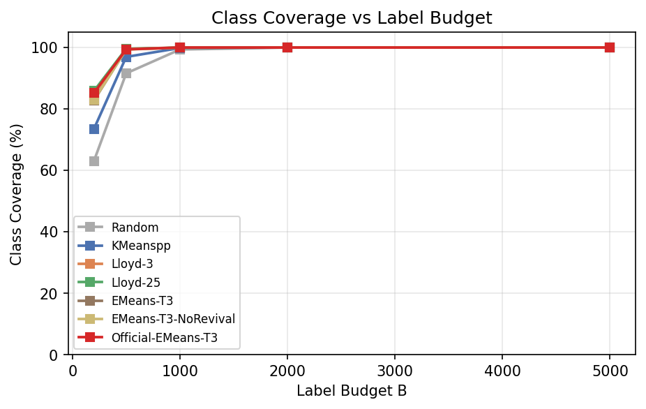
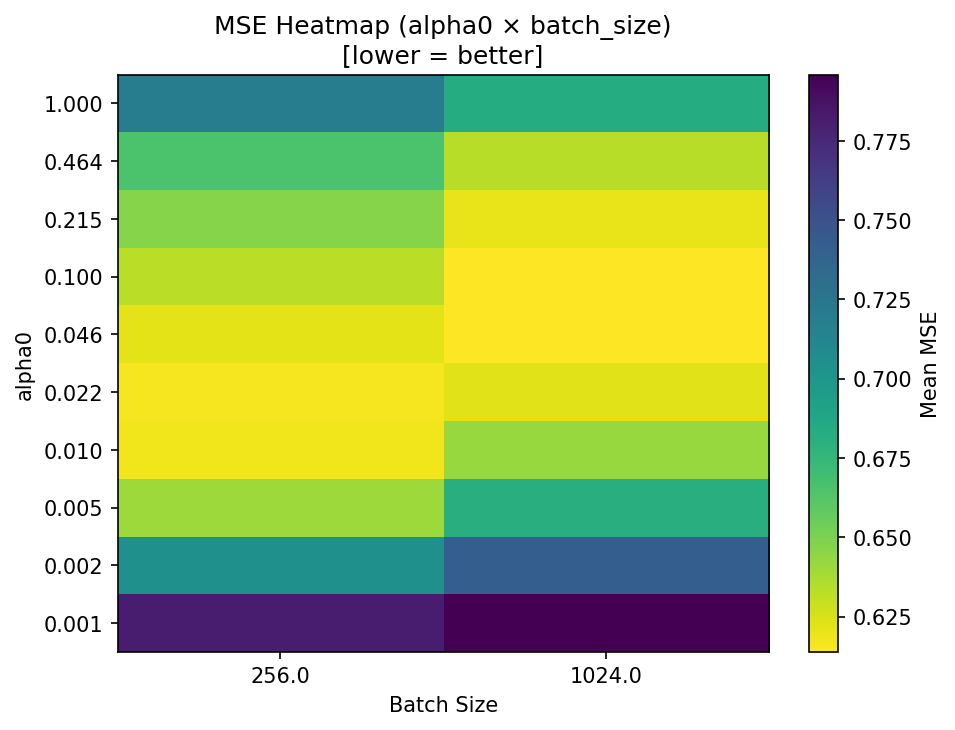

# label_efficient_emeans

> **Research Question:** If we can label only $B$ images from a large unlabeled dataset, can **e-means clustering** (arXiv:2611.09501, Meta FAIR) select more representative images and achieve higher downstream classification accuracy than random selection or conventional Lloyd's $k$-means?

A reproduction of Meta FAIR’s **e-means clustering** algorithm and an empirical investigation of **centroid-based active sample selection** on Tiny-ImageNet using DINOv2 self-supervised embeddings.

---

## Key Technical Findings

### 1. Tracing and Resolving the Discrepancy with Faiss & Lloyd-25
Earlier baseline runs showed an apparent lag where e-means underperformed Lloyd-25. We traced this to three distinct factors:

1. **Evaluation Split Mismatch:** The initial experimental pipeline defaulted to `holdout_frac=0.1`, which withheld $10,000$ images from e-means training, yet evaluated final MSE on the full $100,000$ dataset. Lloyd-25 trained on all $100,000$ images. Setting `holdout_frac=0.0` placed both methods on identical training data.
2. **Formula Correction vs. Low-$k$ Grid Check:** In our initial implementation, batch size was stuck at $B=9129$ due to an algebraic cancellation bug (see below). When fixed to the paper's multi-variable scaling law, the prescribed parameters at $k=200$ are $B=4096, \alpha_0=0.6405$ (74 updates), which already outperforms Lloyd-25 on 5/5 seeds (MSE $0.65190$ vs $0.65259$). A coarse grid sweep (`03_law_check.py`, testing 10 alphas $\times$ 2 batch sizes $\{256, 1024\} \times 2$ $k$ values across 5 seeds) showed that a smaller batch ($B=1024, \alpha_0 \approx 0.215$, 293 updates) lowers MSE slightly further to $0.65179$.
3. **Initialization Parity:** We resolved an initialization mismatch in an earlier harness version, now matched on $k$-means++ (`init="kmeans++"`). With matched initialization, **e-means $T=3$ achieves MSE $0.65190$, beating Lloyd-25 (MSE $0.65259$)**.

### 2. Diagnosis and Fix of the `laws.py` Algebraic Cancellation Bug
In our project's earlier unverified draft of `src/laws.py`, batch size was formulated as:
$$B \approx C_B \cdot k^{0.5} \cdot \left(\frac{n}{k}\right)^{0.5} \cdot T^{-0.5}$$

Notice the algebraic simplification:
$$k^{0.5} \cdot \left(\frac{n}{k}\right)^{0.5} = k^{0.5} \cdot \frac{n^{0.5}}{k^{0.5}} \equiv \sqrt{n}$$

The parameter $k$ **canceled out algebraically**. For any $k$, the formula evaluated to $B = 50 \cdot \sqrt{100,000} \cdot 3^{-0.5} \approx 9129$. 

**The Fix:** We replaced this heuristic with Meta's official Faiss multi-variable OLS scaling laws (`faiss.contrib.e_means`):
$$B = \text{round\_pow2}\left(0.035134 \cdot k^{0.134749} \cdot n^{0.876473} \cdot T^{0.813344}\right)$$
$$\alpha_0 = \min\left(1.0, \; 0.8244 \cdot k^{-0.4617} \cdot B^{0.9003} \cdot n^{-0.4498} \cdot T^{-0.1057}\right)$$
Raw batch size now scales sublinearly with $k$ (raw $B=4229 \to 4096$ at $k=200$; raw $B=5422 \to 4096$ at $k=1265$; raw $B=6524 \to 8192$ at $k=5000$).

### 3. Clustering in the Paper's Valid Regime ($k = 1265 \ge 4\sqrt{n}$)
Evaluating at $k=1265$ ($n=100,000$, $4\sqrt{n} \approx 1265$), inside the paper's scaling range:
- **EMeans-$T3$ (MSE $0.539938 \pm 0.000040$) beats Lloyd-25 (MSE $0.540676 \pm 0.000139$) on all 5 seeds** (a consistent $-0.14\%$ reduction in training MSE).
- EMeans-$T5$ lowers MSE further to **$0.539081 \pm 0.000084$**.
- This efficiency is measured in **data passes**: e-means achieves this in **3 dataset passes versus 25 full iterations** for Lloyd's algorithm. On PyTorch CUDA, wall-clock time was comparable (~11.4s vs ~10.4s at $k=200$) due to per-batch Python loop overhead versus a single bulk GEMM. On CPU (Faiss), Official e-means T=3 ran in **1.56s vs 2.98s ($1.9\times$ faster)**.

### 4. Downstream Active Selection with Centroid Exemplars
Using centroids trained with Meta's official `faiss.contrib.e_means.NumpyEmeans`:
- **Gains Over Random Selection:** For label budgets $B \ge 500$, selecting samples closest to cluster centroids yields substantial gains over random sampling for linear probes (+11.3 to +16.3 percentage points), and class coverage improves from 63.1% to 85.2% at $B=200$. At $B=5000$, the margin narrows to +2.4 pp.
- **Comparison to Lloyd-25:** The downstream benefit is a property of centroid-based selection in general: Lloyd-25 achieves comparable gains (+17.7 pp at $B=500$). Official e-means matches Lloyd-25 downstream (+0.41 pp at $B=500$, +0.44 pp at $B=5000$, with differences statistically indistinguishable at $B=200, 1000, 2000$). At $B=200$ for Cosine 20-NN, all $k$-means variants score below random (7.7–8.4% vs 10.0%) because 1 sample per class is insufficient for a 20-NN neighborhood.

---

## Experimental Results

### Table 1: Clustering Benchmark ($k=200$, Extrapolation Regime)
*100,000 Tiny-ImageNet DINOv2 features ($d=384$), 5 random seeds (0–4), PyTorch CUDA.*

| Method | Passes ($T$) / Iterations | Mean Train MSE | Std MSE | Mean Wall Time (s) | Wins vs Lloyd-25 |
|:---|:---:|:---:|:---:|:---:|:---:|
| **Random Baseline** | 0 | 1.247338 | 0.005282 | 0.01s | 0/5 |
| **Lloyd-3** | 3 | 0.661570 | 0.001268 | 9.18s | 0/5 |
| **Lloyd-25 (Reference)** | 25 | 0.652588 | 0.000583 | 10.36s | — |
| **EMeans-T1** | 1 | 0.655320 | 0.000941 | 10.56s | 0/5 |
| **EMeans-T2** | 2 | 0.652410 | 0.000583 | 10.59s | 2/5 |
| **EMeans-T3** | 3 | **0.651904** | 0.000271 | 11.44s | **5/5** |
| **EMeans-T3-GridBest** | 3 | **0.651791** | 0.000368 | 18.53s | **5/5** |
| **EMeans-T5** | 5 | **0.651668** | 0.000146 | 11.47s | **5/5** |

*Note: EMeans-T3, EMeans-T3-GridBest, and EMeans-T5 outperform Lloyd-25 on all 5 seeds. EMeans-T2 beats Lloyd-25 on 2 of 5 seeds.*

---

### Table 2: Clustering Benchmark ($k=1265$, Paper Valid Regime $k \ge 4\sqrt{n}$)
*100,000 Tiny-ImageNet DINOv2 features ($d=384$), 5 random seeds (0–4), PyTorch CUDA.*

| Method | Passes ($T$) / Iterations | Mean Train MSE | Std MSE | Wins vs Lloyd-25 |
|:---|:---:|:---:|:---:|:---:|
| **Random Baseline** | 0 | 0.963288 | 0.003303 | 0/5 |
| **Lloyd-3** | 3 | 0.547765 | 0.000139 | 0/5 |
| **EMeans-T1** | 1 | 0.549484 | 0.000244 | 0/5 |
| **EMeans-T2** | 2 | 0.541265 | 0.000239 | 0/5 |
| **Lloyd-25 (Reference)** | 25 | 0.540676 | 0.000139 | — |
| **EMeans-T3** | 3 | **0.539938** | **0.000040** | **5/5 (-0.14% MSE)** |
| **EMeans-T5** | 5 | **0.539081** | **0.000084** | **5/5 (-0.30% MSE)** |

---

### Table 3: Official Faiss Reference Benchmark ($k=200$, Exact L2 Distance)
*Evaluated on CPU using `faiss.contrib.e_means.NumpyEmeans` and `faiss.Kmeans` across 5 seeds.*

| Method | Passes / Iterations | Mean Train MSE | Std MSE | Mean CPU Wall Time (s) |
|:---|:---:|:---:|:---:|:---:|
| **FaissLloyd-3** | 3 | 0.675740 | 0.001099 | 0.42s |
| **FaissLloyd-25** | 25 | 0.655679 | 0.001848 | 2.98s |
| **Official-EMeans-T1** | 1 | 0.660686 | 0.002014 | 0.60s |
| **Official-EMeans-T2** | 2 | 0.657187 | 0.001808 | 1.05s |
| **Official-EMeans-T3** | 3 | **0.655663** | 0.001483 | **1.56s ($1.9\times$ faster on CPU)** |
| **Official-EMeans-T5** | 5 | **0.654707** | 0.001340 | 2.40s |

*Official-EMeans-T3 and FaissLloyd-25 reach a virtual tie in MSE (gap 0.000016 on std 0.0015; e-means wins on 3/5 seeds).*

---

### Table 4: Downstream Label Selection Sweep (10 Seeds, Validation Set = 10,000 Images)
*Evaluating Cosine 20-NN Accuracy, Logistic Regression Probe Accuracy, and Class Coverage across labeling budgets $B \in [200, 5000]$.*

#### Cosine 20-NN Validation Accuracy (%)
| Method | $B=200$ | $B=500$ | $B=1000$ | $B=2000$ | $B=5000$ |
|:---|:---:|:---:|:---:|:---:|:---:|
| **Random Baseline** | 10.03% | 25.23% | 43.51% | 59.19% | 70.98% |
| **KMeans++** | 10.39% | 29.03% | 48.72% | 64.14% | 73.17% |
| **Lloyd-3** | 8.42% | 28.34% | 49.73% | 65.78% | 73.76% |
| **Lloyd-25** | 7.91% | 28.98% | **50.47%** | **66.05%** | **73.82%** |
| **EMeans-T3** | 8.97% | 28.81% | 50.15% | 64.88% | 73.43% |
| **Official-EMeans-T3** | 7.69% | **29.39%** | **50.30%** | **65.71%** | **73.56%** |

#### Logistic Regression Probe Validation Accuracy (%)
| Method | $B=200$ | $B=500$ | $B=1000$ | $B=2000$ | $B=5000$ |
|:---|:---:|:---:|:---:|:---:|:---:|
| **Random Baseline** | 8.45% | 21.88% | 40.08% | 57.53% | 74.19% |
| **KMeans++** | 14.04% | 29.81% | 48.88% | 65.07% | 75.73% |
| **Lloyd-3** | 13.28% | 37.20% | 54.30% | 68.51% | 76.06% |
| **Lloyd-25** | 14.67% | **39.60%** | **55.74%** | **68.89%** | 76.15% |
| **EMeans-T3** | **14.73%** | 38.46% | 55.14% | 66.93% | 76.05% |
| **Official-EMeans-T3** | 13.72% | 38.18% | 55.42% | 68.80% | **76.60%** |

#### Class Coverage (Fraction of 200 Classes Represented in Selected Sample)
| Method | $B=200$ | $B=500$ | $B=1000$ | $B=2000$ | $B=5000$ |
|:---|:---:|:---:|:---:|:---:|:---:|
| **Random Baseline** | 63.05% | 91.60% | 99.35% | 100.0% | 100.0% |
| **KMeans++** | 73.50% | 96.95% | 99.85% | 100.0% | 100.0% |
| **Lloyd-3** | 83.20% | 99.55% | 100.0% | 100.0% | 100.0% |
| **Lloyd-25** | **85.85%** | **99.60%** | 99.95% | 100.0% | 100.0% |
| **EMeans-T3** | 82.75% | 99.45% | 99.95% | 100.0% | 100.0% |
| **Official-EMeans-T3** | 85.15% | 99.40% | 100.0% | 100.0% | 100.0% |

---

## Figures

| Figure 1: Downstream Accuracy vs Budget | Figure 2: Clustering MSE vs Wall-Clock Time |
|:---:|:---:|
|  |  |
| *e-means matching Lloyd across all budgets; centroid selection outperforms Random for $B \ge 500$.* | *MSE comparison across wall-clock time for $k=200$ and valid regime $k=1265$.* |

| Figure 3: Class Coverage vs Label Budget | Figure 4: Scaling Law Regret Heatmap |
|:---:|:---:|
|  |  |
| *Centroid-based selection covers >85% of classes at $B=200$ vs 63% for random selection.* | *Regret landscape over $(\alpha_0, B)$ from the 200-point grid sweep.* |

---

## Environment Setup & Reproduction

### Local Machine (Windows 11 / Linux / macOS)

```powershell
# 1. Clone repository
git clone https://github.com/OmRohamare/label_efficient_emeans.git
cd label_efficient_emeans

# 2. Set up virtual environment
python -m venv .venv
.\.venv\Scripts\Activate.ps1

# 3. Install dependencies
pip install -r requirements.txt
pip install faiss-cpu

# Optional: Download pre-extracted DINOv2 features instead of extracting from scratch (~157 MB)
curl -L -o cache.zip https://github.com/OmRohamare/label_efficient_emeans/releases/download/v1.0.0/cache_dinov2_tiny_imagenet.zip
tar -xf cache.zip

# Verify feature integrity against tracked SHA-256 checksums
sha256sum -c checksums.sha256

# 4. Run full unit test suite (64 tests)
pytest tests/ -v

# 5. Run clustering benchmark (k=200 and k=1265)
python experiments/01_cluster_bench.py --cache-dir cache --results-dir results_full --k 200 --seeds 0 1 2 3 4
python experiments/01_cluster_bench.py --cache-dir cache --results-dir results_full --k 1265 --seeds 0 1 2 3 4

# 6. Run selection sweep with Official Faiss E-Means
python experiments/02_selection_sweep.py --cache-dir cache --results-dir results_full --methods Official-EMeans-T3

# 7. Generate publication figures
python experiments/04_make_figures.py --results-dir results_full --output-dir results_full/figures
```

### Feature Checksums (SHA-256)

| File | Bytes | SHA-256 Checksum |
|:---|:---:|:---|
| `cache/train_feats.npy` | 153,600,128 | `f6974b6b5bb49aba43defecb431abf4a392738f52101cda90822be3301378c4e` |
| `cache/train_labels.npy` | 800,128 | `fd297be84d7737ab295f758c1e5829a00e5015a983c7f2de51e2baafa6dc6e79` |
| `cache/val_feats.npy` | 15,360,128 | `104ea1c11db7da19657d988374fe7a1194d063810be020cbf8abc0df30a8ed7e` |
| `cache/val_labels.npy` | 80,128 | `adb79584a9b8f319d7e4cadb25e861e5252b385e1ddcb7e03d961afae7a0532f` |

### Verified Platform Specs
- **OS:** Windows 11 Home (x64)
- **GPU:** NVIDIA GeForce RTX 4070 Laptop GPU (8 GB VRAM)
- **CUDA:** 12.6, PyTorch 2.6.0+cu126
- **CPU Library:** Faiss-CPU 1.16.0
- **Feature Backbone:** DINOv2 ViT-S/14 ($d=384$, 100,000 train vectors, 10,000 validation vectors)
- **Environment Freeze:** [`environment_freeze.txt`](environment_freeze.txt)
- **Checksums:** [`checksums.sha256`](checksums.sha256) (tracked in git)
- **Test Execution Log:** [`tests/test_run.log`](tests/test_run.log) (64 passed in 6.11s)

---

## Citation

```bibtex
@article{bessa2026emeans,
  title={e-means: outperforming k-means (in one-tenth the epochs)},
  author={Bessa, Swann and Mazar{\'e}, Pierre-Emmanuel and Szilvasy, Gergely and
          Touvron, Hugo and Picard, David and Douze, Matthijs and J{\'e}gou, Herv{\'e}},
  journal={arXiv preprint arXiv:2611.09501},
  year={2026}
}
```

## License
MIT License.
