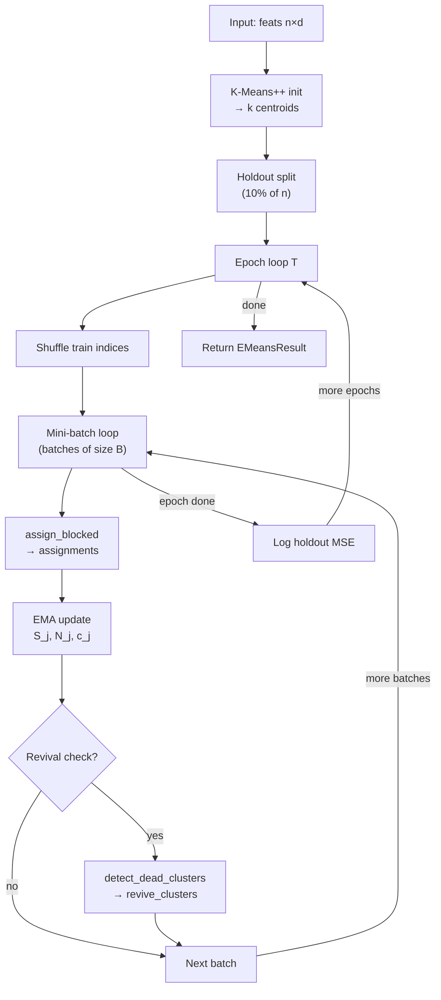

# Algorithm Notes

Mathematical description of the **e-means** algorithm and supporting methods.

---

## 1. Notation

| Symbol | Meaning |
|---|---|
| $n$ | Number of training points |
| $k$ | Number of clusters / centroids |
| $d$ | Feature dimension |
| $T$ | Number of passes over the data |
| $B$ | Mini-batch size per update step |
| $\alpha$ | Current EMA step-size |
| $\alpha_0$ | Initial step-size |
| $\mathbf{x}_i \in \mathbb{R}^d$ | L2-normalised feature vector |
| $\mathbf{c}_j \in \mathbb{R}^d$ | Centroid of cluster $j$ |
| $\mathbf{S}_j$ | EMA feature accumulator for cluster $j$ |
| $N_j$ | EMA count accumulator for cluster $j$ |

---

## 2. Assignment (blocked)

For each point $\mathbf{x}_i$, find the nearest centroid:

$$
a_i = \arg\min_{j \in [k]} \|\mathbf{x}_i - \mathbf{c}_j\|^2
$$

**Efficient computation** (avoids $O(nkd)$ materialisation via BLAS):

$$
\|\mathbf{x}_i - \mathbf{c}_j\|^2 = \|\mathbf{x}_i\|^2 - 2\,\mathbf{x}_i^\top \mathbf{c}_j + \|\mathbf{c}_j\|^2
$$

Implemented in `src/assign.py::assign_blocked` with configurable `block_size` to stay within GPU memory.

---

## 3. E-Means: EMA Mini-Batch Update

After assigning a mini-batch $\mathcal{B}$ of size $B$:

For each cluster $j$, let $\mathcal{B}_j = \{i \in \mathcal{B} : a_i = j\}$ and $n_j^{(t)} = |\mathcal{B}_j|$:

$$
\mathbf{s}_j^{(t)} = \frac{1}{n_j^{(t)}} \sum_{i \in \mathcal{B}_j} \mathbf{x}_i \quad \text{(batch mean)}
$$

**EMA updates:**

$$
\mathbf{S}_j \leftarrow (1 - \alpha)\,\mathbf{S}_j + \alpha\,\mathbf{s}_j^{(t)}
$$

$$
N_j \leftarrow (1 - \alpha)\,N_j + \alpha\,n_j^{(t)}
$$

**Centroid:**

$$
\mathbf{c}_j = \mathbf{S}_j \,/\, N_j
$$

---

## 4. Cosine Step-Size Schedule

The step-size $\alpha$ decays from $\alpha_0$ to $\alpha_0/10$ over all $M$ update steps:

$$
\alpha^{(t)} = \frac{\alpha_0}{10} + \frac{\alpha_0 - \alpha_0/10}{2}
\left(1 + \cos\!\left(\frac{\pi t}{M}\right)\right)
$$

where $M = T \cdot \lceil n / B \rceil$.

---

## 5. Scaling Laws (⚠️ UNVERIFIED)

> **Warning:** These coefficients are BEST ESTIMATES derived from the paper description, **not** directly read from the PDF. All constants are marked `# UNVERIFIED` in code.

$$
B^* \approx C_B \cdot k^{0.5} \cdot (n/k)^{0.5} \cdot T^{-0.5}
$$

$$
\alpha_0^* \approx C_\alpha \cdot k^{-0.3} \cdot (n/k)^{-0.2} \cdot T^{-0.5}
$$

---

## 6. Dead-Cluster Revival

A cluster $j$ is **dead** if:

$$
N_j < \tau \cdot \overline{N} \quad \text{where} \quad \overline{N} = \frac{1}{k}\sum_{j=1}^k N_j
$$

Default $\tau = 0.1$. When a dead cluster is detected:

1. Find the cluster $j^*$ with maximum $N_{j^*}$.
2. Set $\mathbf{c}_j = \mathbf{c}_{j^*} + \epsilon$, $N_j = N_{j^*}/2$, $N_{j^*} = N_{j^*}/2$.
3. $\epsilon$ is a small random Gaussian perturbation.

---

## 7. Lloyd's Algorithm as a Special Case

Setting $B = n$, $\alpha = 1$, and no schedule reduces e-means to one full Lloyd iteration:

$$
\mathbf{c}_j^{(t+1)} = \frac{1}{|C_j|} \sum_{i \in C_j} \mathbf{x}_i
$$

This is verified in `tests/test_emeans.py::test_emeans_lloyd_equiv`.

---

## 8. K-Means++ Initialisation

Centroids are initialised via k-means++ (Arthur & Vassilvitskii, 2007):

1. Sample $\mathbf{c}_1$ uniformly from $\{\mathbf{x}_i\}$.
2. For $j = 2, \ldots, k$: sample $\mathbf{x}_i$ with probability $\propto \min_{l < j} \|\mathbf{x}_i - \mathbf{c}_l\|^2$.

---

## 9. Training Pipeline

---

## 10. Mean Squared Error

$$
\mathrm{MSE} = \frac{1}{n} \sum_{i=1}^{n} \|\mathbf{x}_i - \mathbf{c}_{a_i}\|^2
$$

Computed in `src/assign.py::compute_mse`. For L2-normalised features, MSE ∈ [0, 4].
